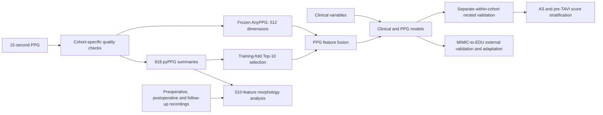

# PulseAS

Core research code for **Integrating Deep PPG Representations and Digital Biomarkers for Aortic Stenosis Detection with Peri-TAVI Assessment**.

PulseAS combines frozen photoplethysmography (PPG) representations, waveform biomarkers and clinical information for aortic stenosis (AS) assessment. This compact release contains the signal adapters, eight internal modelling strategies, MIMIC-to-EDU transfer procedures, clinical comparisons, score stratification and longitudinal morphology statistics. The additional source-trained Net1D is available for external evaluation.

[中文说明](README_zh.md) · [Input format](docs/data_format.md) · [Reproducibility](docs/reproducibility.md) · [Source provenance](docs/source_manifest.json)



## Installation

Python **3.11** is recommended for the recorded study environment. The CPU feature-level demo also supports Python 3.12. Install from a repository checkout:

```bash
python -m venv .venv
# Windows: .venv\Scripts\activate
# Linux/macOS: source .venv/bin/activate
python -m pip install -e '.[dev]'
python -m pytest -q -m 'not gpu'
python -m pulseas demo --output outputs/demo
```

The demo creates synthetic patient tables, simulated 918-dimensional morphology features and 512-dimensional representations, example native-rate pulse signals and repeated observations. It runs nested validation, transfer/adaptation, performance estimation, case enrichment and morphology statistics. **Demo embeddings are simulated; they are not outputs of AnyPPG. Demo scores are not study results or clinical validation.** No clinical data, pretrained weights, GitHub token or network access is required by the demo.

For the complete study implementation, use a compatible CUDA PyTorch installation and install the signal/model extras:

```bash
python -m pip install -e '.[neural,signals,dev]'
```

`requirements-lock.txt` records the tested study versions; the original CUDA build was PyTorch 2.0.1+cu117. Select the corresponding PyTorch distribution for your platform. CUDA is required by the study AnyPPG, XGBoost and neural training paths; these paths raise an error instead of silently changing devices. L2 logistic regression and statistical analyses run on CPU.

## Core analyses

Run from the repository root. Replace angle-bracket paths with your locally authorised inputs. All outputs are local and excluded from Git.

```bash
# Quality-screen raw EDU 15-second recordings; records include processing_state.
python -m pulseas prepare --data <raw-edu-folder> --cohort EDU --output outputs/edu_prepared

# MIMIC selection: non-overlapping 30-second parents -> native 15-second segments.
python -m pulseas prepare --data <mimic-parent-folder> --cohort MIMIC --upstream-extppg <Ext-PPG-Processing-directory> --output outputs/mimic_prepared

# Real morphology extraction and frozen AnyPPG representation generation.
python -m pulseas extract --data outputs/edu_prepared --cohort EDU --encoder-code <AnyPPG/load_anyppg/resnet1d.py> --checkpoint <anyppg_ckpt.pth> --output outputs/edu_features

# Internal development and evaluation are separate in each cohort.
python -m pulseas validate --data <edu-feature-folder> --cohort EDU --folds <edu-frozen-folds.json> --output outputs/internal_edu
python -m pulseas validate --data <mimic-feature-folder> --cohort MIMIC --output outputs/internal_mimic

# Source-only fitting; unchanged zero-shot evaluation, then target adaptation.
python -m pulseas transfer --source <mimic-feature-folder> --target <source-compatible-edu-feature-folder> --roles <frozen-transfer-roles.json> --encoder-code <AnyPPG/load_anyppg/resnet1d.py> --output outputs/transfer

# Performance and optional subgroup summaries.
python -m pulseas evaluate --predictions <oof.csv> --cohort EDU --patients <patients.csv> --output outputs/evaluation

# Matched clinical baselines, with identical patients, classifier and folds.
python -m pulseas evaluate --data <edu-feature-folder> --cohort EDU --folds <edu-frozen-folds.json> --clinical-comparisons main --output outputs/clinical_main
# Additional branches: --clinical-comparisons complete or spline

# Rank the cohort by its calibrated OOF AS score; pre_tavi is independent metadata.
python -m pulseas stratify --predictions <oof.csv> --patients <patients.csv> --output outputs/strata.csv

# Disease-associated and longitudinal morphology statistics.
python -m pulseas morphology --data <edu-feature-folder> --cohort EDU --longitudinal <patient-stage-features.csv> --output outputs/morphology
# Optional real-time pulse templates: --waveforms <waveform-folder>
```

`--config` is a global argument placed **before** the subcommand. `configs/study.yaml` retains study budgets and requires the inherited EDU folds. `configs/demo.yaml` uses smaller synthetic-only budgets. Model identifiers and publication names are:

| Identifier | Strategy |
|---|---|
| `full_pyppg` | Full morphology + ExtraTrees |
| `clinical` | Clinical + L2 logistic regression |
| `anyppg` | Frozen AnyPPG + XGBoost |
| `fusion_top10` | AnyPPG + Top-10 morphology + XGBoost |
| `neural_fusion` | AnyPPG + Top-10 morphology + MLP |
| `clinical_fusion` | PulseAS–XGB |
| `clinical_neural_fusion` | PulseAS–MLP |
| `clinical_fusion_logistic` | PulseAS–L2 |
| `net1d` | Additional waveform model in external transfer |

Use `--models clinical,clinical_fusion_logistic` to select a subset explicitly. Source and target cohorts are never pooled for internal model development. AS and pre-TAVI case capture have separate denominators. Pre-TAVI membership and postoperative observations are not AS model predictors.

## Data, third-party models and reproducibility

This repository contains **code and a synthetic-data generator only**. Clinical data, linkage tables, patient-level OOF predictions and trained weights are not distributed. Access to EDU data requires the relevant institutional authorisation. MIMIC access remains subject to the applicable PhysioNet agreements; this repository does not provide or bypass access credentials.

Obtain [AnyPPG](https://github.com/Ngk03/AnyPPG) and its checkpoint from the upstream project. Use the `load_anyppg/resnet1d.py` implementation for the 512-dimensional representation. The study implementation/checkpoint hashes are recorded in [upstream_hashes.json](docs/upstream_hashes.json). The encoder uses a central ten-second input through the recorded resampling adapter, and remains frozen. Source-trained Net1D uses the same upstream architecture with a new classification head, initialised independently. [Shenda Hong's resnet1d](https://github.com/hsd1503/resnet1d) is credited as the architecture implementation upstream.

Ext-PPG quality utilities must be supplied separately; the study used upstream commit `667dc0f307de93d938c22f83feaeccc0b8e08cdf`. The repository does not vendor external packages or checkpoints. See [third-party notices](THIRD_PARTY_NOTICES.md).

Exact numerical reproduction of manuscript results requires the corresponding frozen inputs, patient order, inherited folds, source model provenance and software environment. The synthetic demo verifies the public interfaces. It does not reproduce the manuscript AUROCs. See [reproducibility.md](docs/reproducibility.md) for preserved functions, experiment boundaries and local verification scope.

## Project structure

The `src/pulseas` package contains one module each for input alignment, signal processing, features, models, validation, transfer, evaluation, stratification and morphology. Configurations and the feature schema are in `configs`. `examples` contains only the synthetic generator; `tests` contains patient-isolation and statistical checks. Historical AR experiments, manuscript production, patient identity reconciliation, exploratory model branches and data-download credentials are outside this compact release.

Original project code in this release is licensed under MIT. Third-party software and weights retain their own terms.
