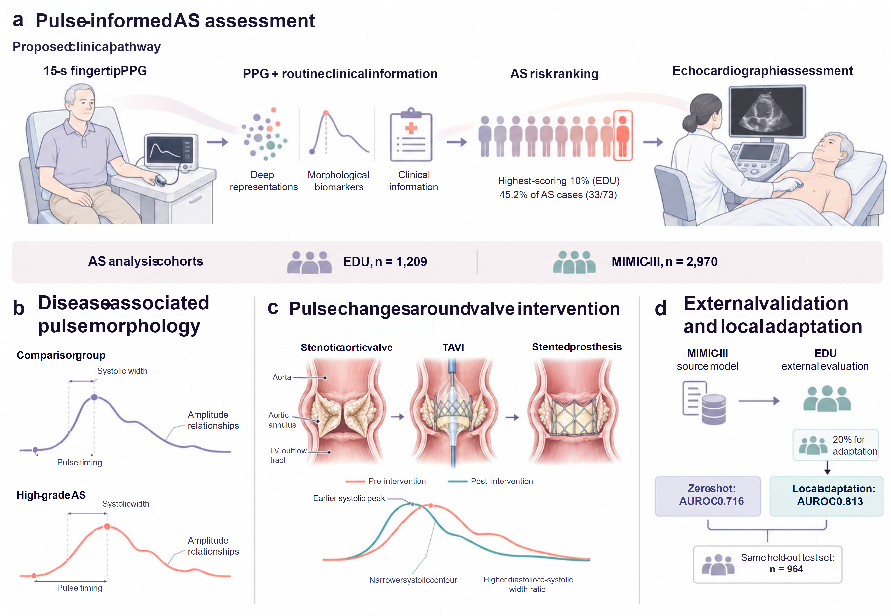

# PulseAS

Research code for **Integrating Deep PPG Representations and Digital Biomarkers for Aortic Stenosis Detection with Peri-TAVI Assessment**.

PulseAS integrates deep photoplethysmography (PPG) representations, waveform biomarkers and routine clinical information for high-grade aortic stenosis (AS) assessment. The core workflow covers model development, cross-cohort validation and adaptation, AS/pre-TAVI score stratification and perioperative pulse analysis.

[中文说明](README_zh.md) · [Quick start](#quick-start) · [Data format](docs/data_format.md) · [Analysis guide](docs/reproducibility.md)

## Study overview

[](assets/fig1workflow.svg)

**Figure 1. PulseAS study overview.** Short PPG recordings and clinical information support AS assessment, with complementary analyses of disease-associated morphology, pulse changes around valve intervention, and MIMIC-III-to-EDU external validation and local adaptation. [Open the full-size figure](assets/fig1workflow.png).

## Data availability

This repository provides core analysis code, configurations and a synthetic example. Clinical data, patient-level predictions and trained weights are not included. EDU data access requires institutional authorisation; MIMIC-III access follows the applicable PhysioNet requirements.

Prepare authorised, analysis-ready patient tables and PPG recordings using the [input format](docs/data_format.md). Patient matching, manual screening and clinical annotation precede this pipeline and are not implemented here.

## Quick start

### 1. Install

Python 3.11 is recommended; the CPU demo also supports Python 3.12.

```bash
git clone https://github.com/Joseph-wang-sus/PulseAS.git
cd PulseAS
python -m venv .venv
# Linux/macOS: source .venv/bin/activate
# Windows: .venv/Scripts/activate
python -m pip install -e '.[dev]'
```

### 2. Run the synthetic example

```bash
python -m pulseas demo --output outputs/demo
```

The example generates fictional patients, simulated features and longitudinal observations, then runs validation, transfer, evaluation, score stratification and morphology statistics. It requires neither clinical data nor pretrained weights. Simulated representations are not AnyPPG outputs, and demo results do not represent manuscript performance.

### 3. Inspect the outputs

Inputs and results are written under `outputs/demo`, with score and summary tables for each analysis. Generated data, model files and outputs are ignored by Git.

## Research workflow

```text
15-second PPG recordings
    → Signal preprocessing
    → Waveform biomarkers + frozen AnyPPG representations
    → Fusion with clinical information
    → Separate within-cohort validation / cross-cohort transfer
    → Performance, score stratification and morphology analysis
```

EDU and MIMIC-III models are developed and internally evaluated separately. Transfer develops the source model in MIMIC-III and evaluates it in EDU before and after local adaptation. Perioperative recordings provide a separate morphology analysis.

Install additional dependencies for signal extraction and neural models:

```bash
python -m pip install -e '.[neural,signals,dev]'
```

Study AnyPPG, XGBoost and neural training paths require compatible CUDA/PyTorch installations. The CPU demo uses a smaller feature-level workflow. Study dependency versions are in `requirements-lock.txt`.

| Command | Purpose |
| --- | --- |
| `prepare` | Prepare signals or check feature inputs |
| `extract` | Extract biomarkers and frozen AnyPPG representations |
| `validate` | Develop and validate models within each cohort |
| `transfer` | Run external validation and local adaptation |
| `evaluate` | Summarise performance and clinical comparisons |
| `stratify` | Calculate AS/pre-TAVI case capture and enrichment |
| `morphology` | Analyse cross-sectional and longitudinal pulse morphology |
| `demo` | Run the synthetic example |

Representative feature-level commands:

```bash
python -m pulseas validate --data <edu-features> --cohort EDU --folds <folds.json> --output outputs/edu
python -m pulseas validate --data <mimic-features> --cohort MIMIC --output outputs/mimic
python -m pulseas transfer --source <mimic-features> --target <source-compatible-edu-features> --models clinical_fusion --output outputs/transfer
python -m pulseas stratify --predictions <oof.csv> --patients <patients.csv> --output outputs/strata.csv
```

Use `python -m pulseas <command> --help` for arguments. Global `--config` goes before the command. `configs/study.yaml` contains study settings; `configs/demo.yaml` contains example settings. The [analysis guide](docs/reproducibility.md) describes model names and validation design.

## Code layout

| Path | Purpose |
| --- | --- |
| `assets/` | Manuscript Figure 1 |
| `configs/` | Study/demo settings and feature schema |
| `src/pulseas/preprocessing.py`, `features.py` | Signal processing, biomarkers and frozen representations |
| `src/pulseas/models.py`, `validation.py`, `transfer.py` | Models, internal validation and external adaptation |
| `src/pulseas/evaluation.py`, `stratification.py`, `morphology.py` | Performance, score stratification and morphology |
| `examples/` | Synthetic-data generator |
| `docs/`, `tests/` | Input guide, analysis guide and core checks |

## Third-party models

Obtain the encoder implementation and checkpoint from [AnyPPG](https://github.com/Ngk03/AnyPPG) under upstream terms. Pass their paths to `extract`; see the [model-access and representation guide](docs/reproducibility.md#third-party-model-access). Net1D uses the compatible architecture credited to [Shenda Hong's resnet1d](https://github.com/hsd1503/resnet1d). Extraction also uses pyPPG and NeuroKit2; the optional raw MIMIC adapter requires separately supplied Ext-PPG utilities.

## Checks and licence

```bash
python -m pytest -q -m 'not gpu'
```

Tests and GitHub Actions use synthetic inputs. Exact manuscript results additionally require authorised study data, corresponding splits and third-party weights.

Original PulseAS code is licensed under [MIT](LICENSE). Third-party software and weights retain their terms; see [third-party notices](THIRD_PARTY_NOTICES.md).
